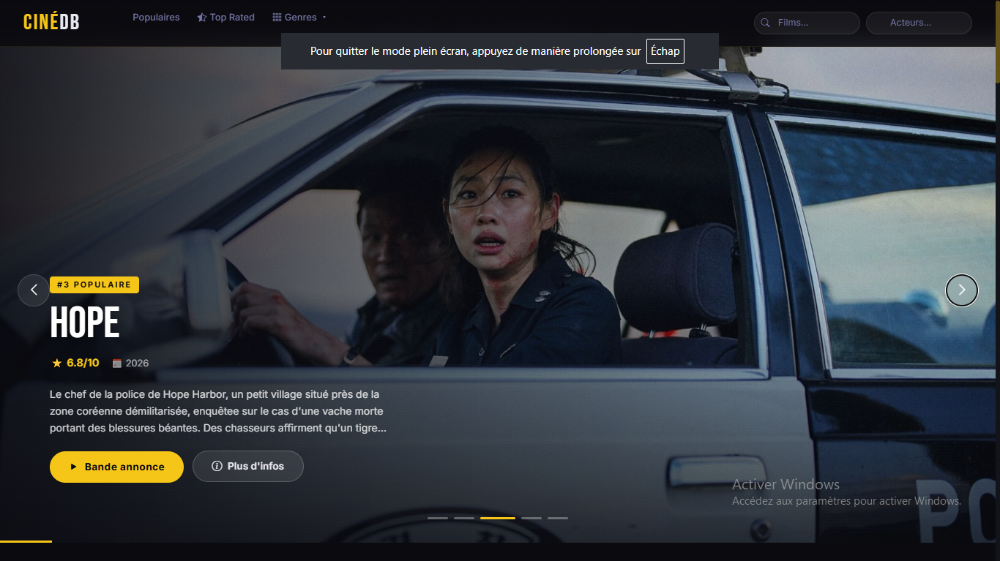

# 🎬 CINÉDB (MovieDB2026)

Une application web PHP moderne inspirée de TMDB pour explorer l'univers du cinéma. Ce projet intègre une architecture solide avec un proxy PHP sur mesure pour communiquer de manière sécurisée avec une API externe.



## 🚀 Fonctionnalités

- **Interface moderne & responsive :** Un design sombre et immersif adapté à tous les écrans.
- **Carrousels et mise en avant :** Affichage dynamique des films populaires et des nouveautés (ex: *Wildwood : La Prophétie de la forêt*).
- **Recherche globale :** Trouvez instantanément des films et des acteurs grâce aux barres de recherche dédiées.
- **Filtrage avancé :** Explorez le catalogue par genre cinématographique ou par classements (*Top Rated*).
- **Proxy PHP Custom :** Architecture sécurisée isolant les clés d'API du côté client.

## 🛠️ Technologies utilisées

- **Backend :** PHP (Architecture propre, Proxy API dédié)
- **Frontend :** HTML5, CSS3 (Intégration moderne), JavaScript
- **API Rest :** Intégration de données cinématographiques externes

## ⚙️ Installation et Configuration

### Prérequis
- Un serveur local (WampServer, XAMPP, Laragon ou PHP CLI)
- Une clé d'API pour le service de films externe

### Étapes
1. **Cloner le dépôt :**
   ```bash
   git clone https://github.com
   cd MovieDB2026
   ```

2. **Ajouter la capture d'écran :**
   Renommez votre image en `screenshot.png` et placez-la à la racine de votre projet (ou modifiez le lien dans le README).

3. **Configurer les variables d'environnement :**
   Créez un fichier de configuration (ex: `config.php`) à la racine et ajoutez votre clé d'API :
   ```php
   <?php
   define('API_KEY', 'VOTRE_CLE_API');
   ```

4. **Lancer le serveur :**
   Démarrez votre serveur web local et pointez vers le dossier du projet.

## 💡 Choix techniques & Architecture

Pour ce projet, l'accent a été mis sur la **sécurité et la performance** :
- **Pourquoi un proxy PHP ?** Au lieu d'interroger directement l'API depuis le JavaScript (ce qui exposerait la clé privée dans le navigateur), les requêtes transitent par un script PHP. Ce dernier joue le rôle de tampon sécurisé.
- **Performance :** Le proxy permet également d'implémenter facilement du cache pour éviter les requêtes redondantes vers l'API externe.

---
⭐️ *Si ce projet vous a plu ou vous a aidé dans vos apprentissages, n'hésitez pas à laisser une étoile !*
